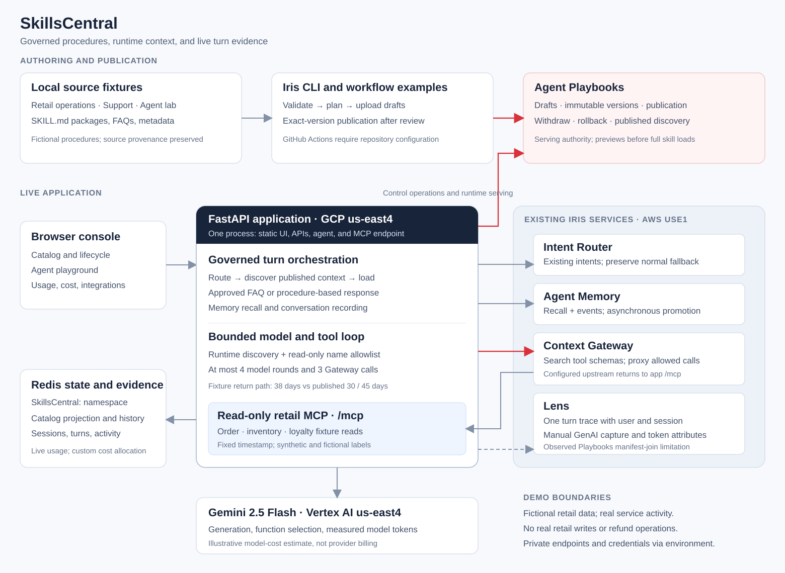
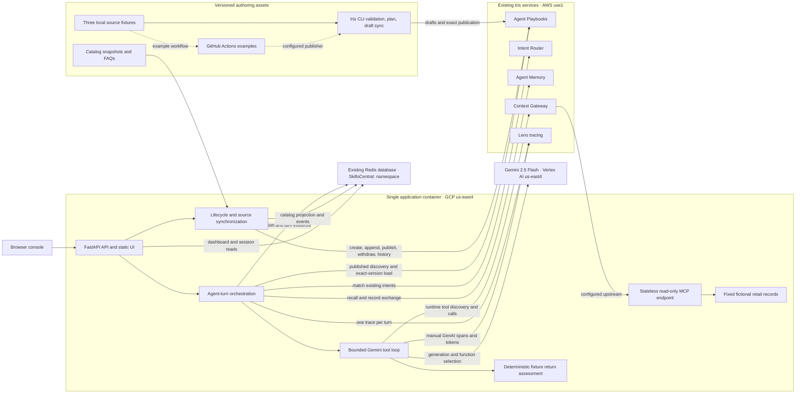
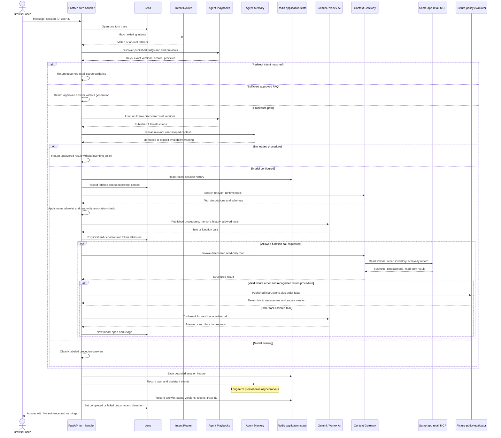

# SkillsCentral architecture

SkillsCentral demonstrates how an agent can discover and use published procedures while an operator manages their lifecycle. The console and agent are a single FastAPI application. Redis Iris supplies the existing Playbook, Intent Router, Agent Memory, Context Gateway, and Lens services; Redis stores the application's catalog projection and live evidence. Gemini 2.5 Flash runs through Vertex AI in `us-east4`.

The procedures, source repositories, and retail records are fictional fixtures. Service requests, model responses, token counts, and recorded turns are real application activity. No synthetic usage history is seeded.



## Components and deployment boundaries



The application and model use GCP `us-east4`. The existing Iris deployment is reused in AWS `use1`; this is a connected cross-cloud demo. Endpoint addresses, credentials, resource identifiers, and deployment-specific names are private environment configuration, not architecture constants.

| Component | Implementation and responsibility |
| --- | --- |
| Browser console | [Static UI](../app/static/app.js): Overview, Skill catalog, Agent playground, Usage & cost, Sources, Integrations, and Demo guide. The browser calls the application's API and does not call Iris with service credentials. |
| FastAPI application | [main.py](../app/main.py): API routes, lifecycle coordination, turn orchestration, session history, error handling, and startup/shutdown. The MCP routes share this application process. |
| Iris adapter | [integrations.py](../app/integrations.py): environment-configured SDK clients, versioned content operations, serving discovery/loading, memory operations, Gateway access, Lens helpers, and safe integration errors. |
| Model/tool loop | [agent.py](../app/agent.py): runtime tool search, read-only allowlist, function declarations, bounded tool calls, explicit model telemetry, and optional deterministic assessment. |
| Fixture policy evaluator | [policy.py](../app/policy.py): extracts the return window from the loaded published procedure and compares it with an explicitly fictional order snapshot. |
| Retail MCP server | [retail_mcp.py](../app/retail_mcp.py): stateless streamable HTTP endpoint at `/mcp`, using the installed MCP server SDK. It reads [fixed retail fixtures](../demo/retail-data.json). |
| Redis evidence store | [store.py](../app/store.py): pooled Redis client, catalog projection, source state, bounded activity/turn logs, and expiring conversation history. Every application key starts with `SkillsCentral:`. |
| Authoring assets | [Catalog fixture](../demo/catalog.json), three source trees under [demo/sources](../demo/sources), and [FAQ files](../demo/faqs). They represent distinct authoring origins without claiming connected remote repositories. |

## Authoring and serving lifecycle

Agent Playbooks is authoritative for published procedure content. The Redis catalog is an application projection used for browsing, version comparison, and reporting; it is not a local replacement for serving discovery.

A skill is a package containing `SKILL.md` with matching directory/frontmatter name, plus optional resources. The CLI also reads `.iris-playbook.json` for discovery intents and metadata. The adapter creates a deterministic ZIP and content digest so an unchanged latest package can be skipped rather than appended again.

The console can create a draft, inspect history, compare the current publication with latest content, publish an exact known version, withdraw an entry, or republish an earlier version. Rollback changes the serving selection while preserving immutable history. Withdrawal removes serving availability and retains the catalog record and historical reporting. The demo exposes no deletion control.

Initial synchronization and reset map the fixture's baseline and candidate snapshots onto actual remote versions. Earlier verification or editing may have created additional versions. Use the IDs returned by the service and displayed in the catalog, never assume the baseline and candidate are versions 1 and 2. Reset restores the intended lifecycle, preserves recorded usage, and retains remote history; restoring a changed candidate can append a new revision.

Normal in-app source synchronization compares the source `SKILL.md` text with the local projection and uploads changed procedure content as a draft while preserving publication. CLI synchronization includes its sidecar metadata. These are related authoring paths with different inputs; changing only a sidecar is not an in-app file-content change.

The supplied [draft synchronization workflow](../.github/workflows/playbook-sync.yml) validates local bundles on pull requests. On main, it previews and uploads drafts with `--publish none` only when the required repository variables and publisher secret are configured. The separate [publication workflow](../.github/workflows/playbook-publish.yml) selects an exact named version when manually dispatched. These are configuration examples, not evidence that remote source synchronization is already installed. No workflow prunes unrelated Playbook entries. See [source synchronization](source-sync.md) for repeatable commands.

## One agent turn



The sequence shows the normal branching structure; an error can stop a branch earlier. In particular, a Playbooks error does not authorize answering from a fabricated local procedure.

### Routing, approved answers, and procedure loading

The existing router intents are preserved. A `prompt_injection` or `off_topic` result produces a scope redirect. No match continues through the general governed agent; a router failure adds a warning and preserves that fallback. The application performs published Playbook discovery before selecting the redirect/answer branch.

A discovered FAQ with an answer and a score of at least `0.85` can be returned directly. This is an application policy, not an automatic entitlement to skip generation for every FAQ result. Otherwise the application loads at most two discovered skills using their returned exact versions. A draft or withdrawn procedure is not substituted from the Redis projection.

No loaded procedure yields an uncovered response. A configured model receives the loaded procedures, relevant recalled memory, and the last six stored conversation messages. Published procedures determine policy; memory and old conversation are contextual input. If no model is configured, the application returns a clearly identified procedure preview rather than claiming an LLM response.

### Runtime tools and bounded execution

The agent searches Context Gateway using up to the first 200 characters of the message and requests at most five results. It builds model function declarations only for discovered tools that pass both the explicit name allowlist and `readOnlyHint` check:

| Gateway tool name | Fixture read |
| --- | --- |
| `skillscentral__get_order` | Order facts and purchase age at the fixture timestamp. |
| `skillscentral__find_store_inventory` | Product/store availability snapshot; no reservation. |
| `skillscentral__get_loyalty_profile` | Fictional tier and illustrative benefits; no account change. |

Gateway proxies these calls back to the same application's `/mcp` endpoint. Every result identifies itself as fictional, synthetic, and read-only, with a fixed `as_of` timestamp. The server has no business-system credentials and no write/refund operation.

The loop permits at most four model rounds and three Gateway calls for a turn. An undiscovered/disallowed request receives an error result rather than being executed. Gateway discovery failure produces a warning and supplies no business tools. The model's automatic function execution is disabled; the application owns dispatch.

### Deterministic return assessment

For a successful fictional order lookup, the application checks whether the loaded procedures include the return-authorization skill. It reads the numeric window from the procedure's recognized wording and validates the fixture purchase age. It also examines proof of purchase, item condition, and final-sale/personalization exclusions.

The demonstration's 38-day order is outside a 30-day publication (`38 > 30`) and inside a 45-day publication (`38 ≤ 45`), subject to the other conditions. The model selects the tool, but this arithmetic path supplies the final assessment directly; it does not use a second generation call to calculate eligibility. The response cites the actual skill version and snapshot time and explicitly says that no authorization or refund was issued.

This evaluator is intentionally narrow. Missing facts, a non-fictional record, or unrecognized procedure wording do not establish eligibility. For other tasks, or a text-only model answer, the general model path remains in use; this helper is not a general policy language or a guarantee that every possible response is deterministic.

## Persistence and reporting

The store maintains only application-owned keys beneath the required `SkillsCentral:` prefix:

| Key suffix | Data structure and purpose |
| --- | --- |
| `sources` | JSON string containing source projection and sync metadata. |
| `catalog` | Sorted set indexing skill keys. |
| `skill:<key>` | JSON string with local metadata, version snapshots, and publication projection. |
| `events` | List retaining the most recent 200 lifecycle events; the activity API reads the latest 30. |
| `turns` | List retaining the most recent 2,000 actual turns, including failures and implementation verification. |
| `session:<user>:<session>` | JSON string retaining up to 12 messages with a 24-hour TTL. |

A shared Redis connection pool uses explicit connection/read timeouts. Independent batched writes use non-transactional pipelines. This is a small demo state model, not a distributed publication coordinator: the process-local mutation lock serializes this application's lifecycle controls, while Playbooks remains the serving authority.

The Usage & cost page aggregates retained turn records. It distinguishes a discovery hit from a full published-procedure load recorded for a turn. Previews or later failures can still have a load; the count does not prove successful model execution or a business action. Zero-use and withdrawn entries remain visible for governance review. Totals reflect the retained evidence window, not guaranteed lifetime usage. The [dedicated usage and cost architecture](usage-and-cost.md) details the runtime capture path, dashboard reads, UTC grouping, and retention.

Model input/output totals come from the generation response, summed across rounds. Output includes returned candidate tokens and reported thought tokens. The app computes an illustrative turn estimate:

```text
estimated model cost = (input tokens × configured input rate
                      + output tokens × configured output rate) / 1,000,000
```

Default rates in this demo are illustrative `$1` input and `$5` output per million tokens; they are not a provider price quote. The dashboard divides a turn's model cost and tokens equally across its loaded skills. This convention is not causal per-skill measurement or provider billing. Iris, tool-service, VM, and support costs are excluded. FAQ/direct redirect/uncovered paths can have no model tokens, while still making context-service calls.

## Tracing, memory, and observed limits

`lens.init()` runs once for the agent, and the chat handler opens one `lens.turn(session_id, user_id=...)`. Iris operations and all model/tool rounds stay inside that turn. The response and Redis evidence include its trace ID. Shutdown flushes Lens before closing the Redis client.

The Gemini client is instrumented explicitly with `gen_ai` request/response model, operation, provider, input/output usage, and loaded skill-key attributes. Selected prompt/completion content is captured only when Lens content capture is enabled. Prompt assembly records fetched discovery/procedure/memory content and the context selected for use. The application's dollar estimate is computed in its turn record; it is not presented as a native Lens billing total.

Live verification observed correct trace/session/user identities, outcomes, model prompt/completion availability, and matching token totals. Memory entered-prompt joins were also visible after prompt-assembly adjustments. The Lens beta read API nevertheless reported `NOT_INSTRUMENTED` for some Playbooks `discover_entries` and `get_skill_version` context-manifest joins despite matching content hashes and an emitted assembly span. No verified fix is claimed. That state is not proof that the skill was unused: the application separately records the exact published skill/version loads. Native Lens joins, SDK emission, and the app's own evidence must be assessed separately.

Agent Memory recall is scoped by the request's user ID. Recorded conversation sessions use a derived ID combining user and session so two demo users do not accidentally share a transcript. Memory outages are explicit warnings. Recording exchange events is not proof that long-term promotion has completed, and no automatic memory-to-approved-FAQ publication pipeline is implemented.

The Integrations screen mixes observed service checks with clearly labeled configuration state: Playbooks/router health, memory health, Gateway tool listing, Lens instrumentation/export counters, Redis connectivity, and model configuration. A configured endpoint or successful process health check alone is not proof that a full turn completed.

## Maintained feature boundaries

| Demonstrated capability | Boundary |
| --- | --- |
| Published procedure lifecycle | Real Playbook drafts, versions, publication, withdrawal, and rollback. The console/provenance view is application code. |
| Source consolidation | Three local fixture trees and executable CLI/workflow examples. Remote GitHub synchronization requires repository configuration. |
| Skill usage | Custom aggregation of retained actual turns and procedure loads, not a native Playbooks usage-analytics product. |
| Cost attribution | Illustrative model-token estimate allocated equally to loaded skills, not billing or causal cost measurement. |
| Context Gateway | Runtime discovery and read-only proxy calls to fixed fictional retail data. No real retail system or write action is connected. |
| Agent Memory | Existing-store recall and event recording. Asynchronous long-term promotion is separate from recording; automatic curated FAQ learning is outside this implementation. |
| Lens | One turn trace and explicit model telemetry, with the observed Playbooks context-manifest join limitation stated above. |
| Deployment | A single application container and region-scoped model calls, reusing existing cross-cloud services. Deployment addresses and resource identifiers stay in private configuration. |

See the [project README](../README.md), [deployment operations](deployment.md), [source synchronization](source-sync.md), and [presenter runbook](../demo/runbook.md) for setup and operation.
