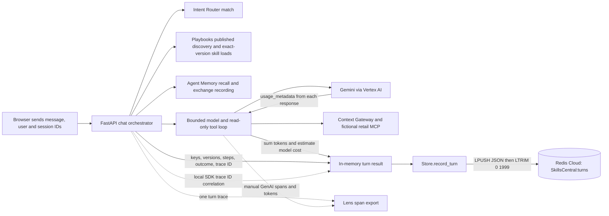
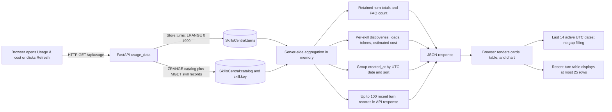

# Usage & cost: capture, storage, and reporting

The dashboard reads **application-owned turn records in the existing shared Redis Cloud database**. Its multi-day Recorded activity chart is computed from `SkillsCentral:turns`, a Redis List of JSON strings. It is not a Lens chart or a live query to Playbooks usage APIs.

The procedures and retail records are fictional. Turn history is actual app activity, including verification requests; no synthetic usage history is seeded. See the [full architecture](architecture.md) for the surrounding agent and service boundaries.

## Flow 1: capture a turn at runtime



The orchestrator opens one Lens turn, calls Iris as needed, and builds a result object. At the end of the handler, `Store.record_turn()` serializes that object and sends `LPUSH` plus `LTRIM` in a non-transactional Redis pipeline. Handled failures also produce an error-mode result when the evidence store remains available. The record contains message/answer, UTC creation time, session/user/trace IDs, discovered entries, loaded skills and versions, steps, warnings, model usage, and any tool-call/assessment evidence.

The Lens SDK assigns the turn's trace ID locally. The app saves it in the Redis record while the exporter sends spans through a separate telemetry path. Loading the Usage & cost dashboard does **not** read Lens; a separate trace-detail endpoint exists for explicit Lens inspection.

## Flow 2: read and aggregate the dashboard



Daily buckets are calculated on each read; there is no separate persisted daily-summary table. A date appears only if at least one retained turn has that UTC date. The chart takes the last 14 such dates, not necessarily the last 14 consecutive calendar days. The server totals cover the retained dataset, even when fewer dates or recent rows are displayed.

## Who calls each component, and when

| Component | Caller and timing | Protocol / data supplied |
| --- | --- | --- |
| Intent Router | Chat orchestrator, at the start of each turn. | Iris SDK request: existing intent match and fallback evidence; no dashboard usage counter is read. |
| Agent Playbooks | Chat orchestrator, before answering; full skills loaded when selected. | Iris SDK: published previews/FAQ answers, relevance scores, exact keys/versions, full procedures. Discovery and loads are recorded separately by the app. |
| Agent Memory | Orchestrator recalls on the procedure path and records exchanges after an answer. | Iris SDK: user-scoped context and conversation events. Asynchronous long-term promotion is separate. This is not the dashboard history backend. |
| Context Gateway / MCP | Model loop searches for relevant tools before generation; invocation occurs when the model requests an allowed discovered tool. | Iris SDK/MCP: tool schemas and read-only fictional results. Tool evidence is copied into the turn result; Gateway is not the dashboard counter store. |
| Gemini / Vertex AI | Model loop, for each generation round that runs. | Google Gen AI SDK: generated content/function calls and response token metadata. Returned usage is summed across rounds. |
| Lens | Turn context and model instrumentation during execution; exporter sends spans separately. | Trace/span telemetry, identities, outcome, context evidence, and explicit GenAI usage/content attributes when enabled. |
| Redis Cloud write | FastAPI calls `Store.record_turn()` near the end of the chat handler. | Redis protocol via a shared `redis-py` pool: JSON string `LPUSH`, then list `LTRIM`. |
| Redis Cloud read | FastAPI handles `GET /api/usage`. | Redis protocol: `LRANGE` for turn history, `ZRANGE`/`MGET` for current catalog records. Aggregation runs in the app. |
| Browser | On page entry or explicit refresh. | HTTP JSON response supplies summary, per-skill rows, daily buckets, recent turns, and reporting methodology. |

## What the numbers mean

A **discovery** means a skill preview appeared in a recorded Playbook result. A **use** counts an entry in the turn's `skills` list, added after a published full-procedure load; the generation path then inserts that procedure into model context. A later failure or procedure-preview path can still leave the load counted without a completed model answer. Discovery is not a load, and a load does not prove that the model followed every instruction or completed a business action. Per-skill rows are initialized from the current catalog, preserving zero-use and withdrawn entries for review.

Input tokens come from response `prompt_token_count`; output includes returned candidate tokens and reported thought tokens. The app sums those values over all model rounds. A round with no returned usage metadata contributes zero recorded tokens; the app does not reconstruct a provider invoice. FAQ, redirect, and uncovered paths can make Iris requests without making a generation call.

```text
turn model estimate = (total input tokens × configured input rate
                     + total output tokens × configured output rate) / 1,000,000
skill attribution   = turn model estimate / number of skills loaded in that turn
```

The input/output rate settings are `DEMO_INPUT_USD_PER_MILLION` and `DEMO_OUTPUT_USD_PER_MILLION`. Their defaults are illustrative `$1`/`$5`, not a provider price quote. Tokens and estimated cost are split equally across the loaded skills for the per-skill table. This is an allocation convention, not measured causal cost. Iris service charges, Gateway/tool-service charges, VM spend, and other infrastructure costs are excluded.

## Multi-day history and retention

| Question | Current behavior |
| --- | --- |
| Where is Recorded activity physically stored? | In the configured shared Redis Cloud database, under the single Redis List key `SkillsCentral:turns`. Each list element is one serialized JSON turn record. It is not stored in browser local storage, local files, or Lens for this chart. |
| How can the chart span several days? | Each retained record has a UTC `created_at` timestamp. On read, the server groups its first ten characters (`YYYY-MM-DD`) into daily buckets. The same list can contain records from many UTC days. |
| What is retained? | The latest 2,000 records, newest first, after each `LPUSH`/`LTRIM`. The app sets no TTL on this list. Older records are removed when the count limit is exceeded. |
| Is there a calendar retention guarantee? | No. Low traffic can span many days; high traffic can replace the retained dataset quickly. The chart's 14-date display limit is not a storage-retention policy. |
| What do totals cover? | All records currently read from the retained list, not lifetime usage. The API returns at most 100 recent records; the UI recent-turn table shows at most 25. |
| Do app restart and demo reset clear history? | No. The data is outside the app process, and reset restores the demo lifecycle while retaining recorded turns. Existing records remain subject to the Redis service state and the list's count limit. |
| Does the 24-hour session TTL apply here? | No. Conversation history is a separate `SkillsCentral:session:<user>:<session>` key, limited to 12 messages with a 24-hour TTL. That expiry does not delete turn evidence. |
| Is this a backup or archival promise? | No. This describes application writes, trimming, and reads only; it makes no claim about Redis service backup configuration, recovery guarantees, or archival storage. |

The dashboard is custom application reporting. Lens independently helps inspect a correlated turn, but observed Playbooks context-manifest join limitations in Lens must not be treated as proof that a skill was unused. The app's exact load evidence and the trace system's context joins are separate observations.

## Source map

- [main.py](../app/main.py): `chat`, `usage_data`, `/api/usage`, and reset behavior.
- [store.py](../app/store.py): `record_turn`, `turns`, `skills`, `now`, and `save_session`.
- [agent.py](../app/agent.py): `generate_answer`, response-token accumulation, and configured cost calculation.
- [integrations.py](../app/integrations.py): Iris operations, model spans, and Lens reads.
- [app.js](../app/static/app.js): `renderUsage`, `daily.slice(-14)`, and recent-row display.
